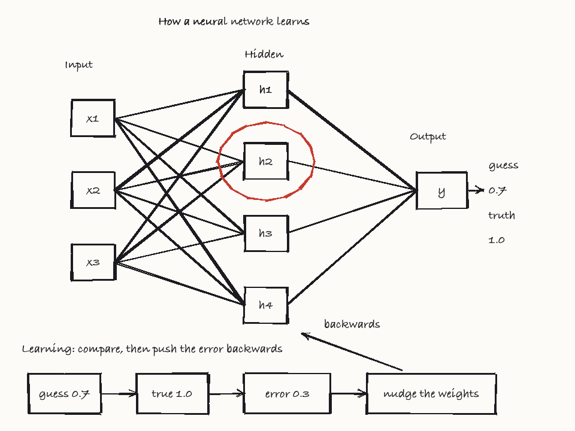
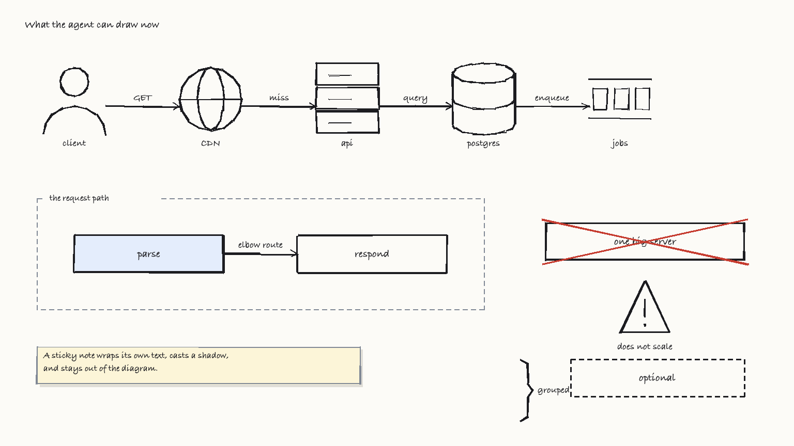

# Scribe

A whiteboard an agent can draw on **while it teaches**.

Teaching at a whiteboard is mostly two things a diagram cannot do: **rubbing
something out**, and **pointing at what you mean**. Half of explaining is
correcting — showing a wrong model, fixing it, clearing space to go deeper —
and the other half is deixis: "*this* queue feeds *that* worker."

Mermaid and SVG describe a finished picture. Neither can erase, and neither can
gesture.

Scribe is the missing piece: a stateful canvas, a small drawing language, and an
MCP server so any agent can draw on it live, narrate as it goes, point at what
it means, and erase what it got wrong.



*Drawn by Claude, one command at a time, while explaining backpropagation.*



*The richer primitives: icons instead of labelled boxes, elbow-routed
connectors, groups, tints, strike-outs and notes.*

**[▶ Watch it draw itself](https://rishabhsinha07.github.io/AgentHarnessToScribe/)** — the same lesson
played back stroke by stroke, narrated aloud. Nothing to install.
(Runs from `docs/`; enable GitHub Pages on `main` / `/docs` to serve it.)

---

## Why a canvas instead of a diagram format

Two things a whiteboard does that no static format can:

**Erasing.** Half of teaching is correcting — showing a wrong model and fixing
it, revealing in stages, clearing space to go deeper. `erase` is a first-class
op, and the canvas reports exactly what it destroyed.

**Pointing.** Teaching from a diagram is mostly deixis: "*this* queue feeds
*that* worker." `circle` draws a red loop around something and says what it is
while drawing it. Nothing in Mermaid can gesture.

---

## Quickstart

```bash
uv sync
uv run scribe-serve examples/neural_network.ops
```

Your browser opens on the board. Press **Start lesson** and it draws itself,
narrating as it goes. (The click is not decoration — browsers refuse to speak
until a page has had one.)

### Narration

Out of the box the board narrates itself with the browser's built-in speech —
no key, no network. For a better voice, set an ElevenLabs key before starting:

```bash
cp .env.example .env        # then paste your key into it
uv run scribe-serve examples/neural_network.ops
```

`.env` is gitignored. An `export ELEVENLABS_API_KEY=sk_...` works too, but puts
the key in your shell history.

A voice picker appears in the controls and the board speaks through ElevenLabs.
**The key stays on the server** — the viewer asks this process for audio and
never sees the credential. If a request fails, it falls back to browser speech
rather than going silent.

| Variable | Default | |
|---|---|---|
| `ELEVENLABS_API_KEY` | *unset* | Without it, ElevenLabs is simply not offered |
| `ELEVENLABS_VOICE_ID` | Sarah | Starting voice; switch live in the picker |
| `ELEVENLABS_MODEL` | `eleven_turbo_v2_5` | Turbo keeps the voice up with the drawing |

A `.env` beside the project works too, and is gitignored — see `.env.example`.

**Narration drives the timeline.** Character count is a poor predictor of how
long a sentence takes to say, so the viewer loads each line's audio ahead of
time and uses its real duration. Without that, roughly one line in six gets
clipped before it finishes.

### As an MCP server

```bash
claude mcp add scribe -- uv run --directory /path/to/scribe scribe-mcp
```

Then ask Claude to teach you something at the whiteboard. It calls
`scribe_open`, you open the URL, and it draws while it talks.

---

## The drawing language

One command per line. Coordinates are a 64 × 36 grid — coarse on purpose, since
models reason about grid cells far better than pixels, and 16:9 so it fills a
browser window.

```
text    x,y <words>            write words
box     x,y,w,h <label>        rectangle, label centred
ellipse x,y,rx,ry <label>      oval in the current pen
arrow   x1,y1 x2,y2 <label>    arrow, label auto-dodges collisions
highlight "<label>" <note>     RED ring, sized from the target's own box
circle  x,y,r <spoken note>    RED ring at a chosen spot (empty space only)

connect "<a>" "<b>" <label>    elbow-routed arrow between two elements
fill    "<label>" <tint>       tint a shape
strike  "<label>" <note>       cross it out

icon    <name> x,y <size> <label>   pictogram (db, server, user, cloud, …)
group   x,y,w,h <label>        dashed container with a label tab
note    x,y,w <text>           sticky note, wraps its own text
brace   x,y,h <label>          vertical brace over a range
dash    on|off                 line style for what follows
pan     <y>                    scroll to fresh board; the surface extends down
stroke  x1,y1 x2,y2 ...        freehand polyline
erase   x,y,w,h <spoken note>  erase a rectangle
pen     ink|red|blue|green|grey
board   W H                    declare the board size (first line only)
page    <title>                wipe to a clean page
say     <text>                 narration, spoken at this moment
```

A lesson reads as draw, speak, point, speak — and that ordering *is* the
teaching. Say **why**, not what; the label already says what:

```
box    5,7 3,2.5 "x1"
box    17,5 3,2.5 "h1"
stroke 8,8.25 17,6.25
say    "Everything connects to everything, because nothing yet knows what matters."
highlight "h1" "Pick any one of them. They are interchangeable."
```

The note on `highlight`, `circle` and `erase` is spoken aloud as the gesture
happens, so the pointer explains itself.

**`highlight` never guesses.** The ring is sized from the target's own bounding
box. A guessed `circle x,y,r` that slices through the thing it means gets
flagged in the report, with the fix named.

---

## MCP tools

| Tool | Does |
|---|---|
| `scribe_reference` | The command reference. Read it first. |
| `scribe_open(topic)` | Opens a lesson and pops the board up in the browser |
| `scribe_plan(...)` | The lesson's spine. **Required** — drawing is refused without it |
| `scribe_draw(ops)` | Draws. Returns errors, collisions, occupancy |
| `scribe_look()` | A PNG of the board, for the agent's own eyes |
| `scribe_erase_preview(x,y,w,h)` | What an erase would destroy, before committing |
| `scribe_undo(scenes)` | Rolls back the last N draw calls and replays |
| `scribe_finish(closing)` | Ends the lesson, so the board stops waiting |
| `scribe_export(out_dir)` | Saves the board as PNG, a replay page, and the ops |
| `scribe_status()` | Topic, ops drawn, viewers connected |

### Why planning is enforced

`scribe_draw` refuses until `scribe_plan` has been called. That is the single
most important thing in the tool surface, and it took a bad lesson to find.

An agent improvising scene by scene writes narration like *"on the left, your
inputs"* — a caption for a box the learner can already see. You write captions
when you decide the line *while* drawing the box. It also fills the board
before reaching the point, so the erase ends up being a space problem rather
than a teaching move.

A plan commits to four things first: the one idea, a hook (a question put on
the board before it is answered), three to five beats that form an argument
rather than a list of shapes, and the payoff. Naming the learner's
misconception is optional and worth more than the rest — a model you draw
*wrong on purpose* and then correct is the one move a finished diagram cannot
make.

The plan comes back with a layout budget, so the board is divided before any
ink lands.

`scribe_draw` returns collisions **as text on every call**. That is the central
design choice: the agent is told about an overlap cheaply, in words, and only
spends an image on `scribe_look` when the text says something is wrong.

### Built for agents to get right

- **The server carries its own instructions.** The MCP server ships the
  teaching discipline — draw in scenes, interleave narration, read the report —
  so any client gets it without you prompting for it.
- **Errors teach.** A malformed op comes back with the correct form:
  `bad args for 'box': expected 4 numbers, got 2. Correct form: box x,y,w,h <label>`
- **Undo, not just erase.** Erasing destroys pixels. `scribe_undo` rebuilds the
  board from the op log and replays it to every viewer.
- **Dry runs before destructive moves.** `scribe_erase_preview` names what a
  rectangle would clip, since the eraser is blunt by design.
- **The board opens itself**, and the server picks a free port rather than
  handing out a URL that never loads.
- **The wait is visible.** A lesson is drawn in scenes, so the board sits idle
  while the agent thinks up the next one. It says so, with a `thinking`
  indicator and a status that moves between *drawing*, *thinking* and *live* —
  a still board with a frozen clock reads as broken.
- **Narration is fetched ahead of playback.** The first spoken line used to pay
  a full round trip while the board drew in silence.
- **Pointing is not guesswork.** `highlight "<label>"` sizes the ring from the
  target's own box, because an agent cannot see how wide a box rendered. The
  same applies to `connect`, `fill` and `strike`: all take labels, and the
  canvas does the geometry.
- **A connector that ploughs through a third element is reported**, naming the
  obstacle — another thing invisible to an agent working blind.

For Claude Code there is also a skill in `.claude/skills/whiteboard-teaching/`
covering layout budgeting, when to point, and what to do about each kind of
report. It is **project-scoped**, so it only loads inside this repo — copy it
to use it anywhere:

```bash
cp -r .claude/skills/whiteboard-teaching ~/.claude/skills/
```

---

## How it fits together

```
agent ──MCP──> scribe.mcp ──> Session ──> Canvas      (state, collisions, PNG)
                                 │
                                 └──WebSocket──> viewer   (draws as ops arrive)
```

One process owns everything. `scribe.live` runs the web server on a background
thread so MCP keeps stdio to itself.

| Module | Role |
|---|---|
| `canvas.py` | Drawing surface, op parser, collision detection, PIL renderer |
| `session.py` | One lesson: canvas + op log + connected viewers |
| `live.py` | Starlette server; streams ops over WebSocket |
| `mcp.py` | MCP adapter |
| `viewer/index.html` | The board: progressive drawing, voice, scrubbing |
| `voice.py` | Optional ElevenLabs narration, proxied so the key stays server-side |
| `cli.py` | `scribe-serve`, for running without an MCP client |
| `.claude/skills/` | The teaching skill, for Claude Code |

---

## What the canvas tells the agent

Every `scribe_draw` returns a report that leads with the problems:

```
Page 0 of a 40x30 grid. 28 elements, 38% full.
COLLISIONS -- 1 overlapping elements:
  x text (16.5,1.98)-(19.6,3.03) 'Hidden' overlaps text (11,0.98)-(25,2.03) 'How a neural network learns'
```

That is a real defect from the first run of the example lesson, caught
automatically on a re-run. Highlights and freehand are exempt from collision
checks — they are *meant* to cross things.

## Keeping a lesson

`scribe_export` writes three things to `~/.scribe/lessons`:

| | |
|---|---|
| `<topic>.png` | The whole board, every screen of it, as one tall image |
| `<topic>.html` | A **self-contained replay** — opens in any browser, no server, and redraws the lesson with its narration |
| `<topic>.json` | The op-stream and the plan behind it |

The replay is the one that matters: it is the thing you can send someone. It
is also why `pan` exists rather than erasing for space — a lesson that rubs
itself out as it goes has nothing left to export.

## Status

Early. The canvas, the language, the viewer and the MCP server work. The
original goal — training a small local model to draw and teach this way — is
next; the op-streams this produces are the training data.

## License

MIT
